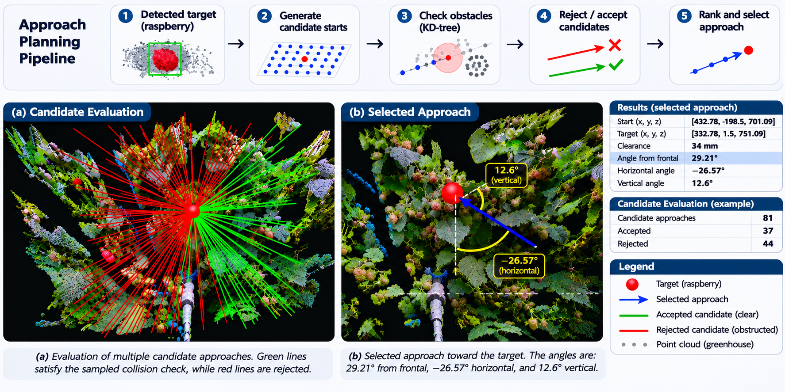
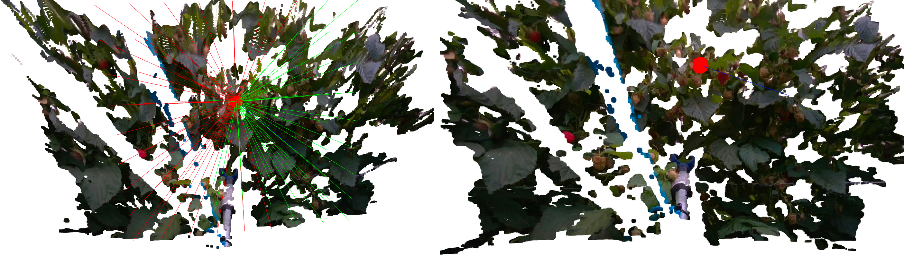

# Robotic Perception & Approach Planning for Raspberry Harvesting

**Robotics & Computer Vision R&D | VDL Cropteq**

An applied robotics project exploring the use of deep learning, RGB-D perception, 3D point-cloud processing, and geometric approach planning for autonomous raspberry harvesting in greenhouse environments.

My work progressed from researching and adapting a semantic segmentation architecture to processing real greenhouse point clouds, developing an obstacle-aware approach planner, and beginning work on robotic simulation.

The project involved four main workstreams:

- **Deep Learning:** Researching real-time semantic segmentation architectures and adapting BiSeNet V2 for greenhouse perception.
- **3D Perception:** Processing greenhouse point clouds, investigating scan alignment, and applying geometric filtering.
- **Approach Planning:** Developing an algorithm to evaluate possible approach directions to a raspberry while avoiding surrounding obstacles.
- **Simulation:** Beginning development of a virtual environment for testing robotic behavior without continuous access to the greenhouse.

### Approach-Planning Visualization

The following illustration summarizes the geometric approach-planning algorithm, including candidate generation, obstacle evaluation, and final approach selection.

*Figure 1. Conceptual illustration of the approach-planning workflow and selected trajectory.*

#### Actual Prototype Visualization

The following screenshot shows the approach planner running on a real greenhouse point cloud.

*Figure 2. Actual Open3D prototype: candidate approach evaluation (left) and selected raspberry approach (right).*

> **Note:** This repository documents my engineering contributions and prototype development at VDL Cropteq. Proprietary company code, datasets, and trained models are not publicly included.

---

## 1. Problem Statement

Autonomous raspberry harvesting requires more than detecting fruit.

A robotic manipulator must approach a raspberry while navigating around leaves, stems, support wires, and other surrounding plant structures. These obstacles make it difficult to determine an appropriate approach direction.

The project investigated three interconnected challenges:

1. **Scene Understanding:** Identifying important greenhouse structures using computer vision.
2. **3D Perception:** Processing depth observations into useful geometric representations of the greenhouse environment.
3. **Approach Planning:** Determining suitable approach directions to a selected raspberry based on nearby obstacles.

An additional objective was to explore robotic simulation, allowing development and testing to continue when the physical greenhouse was unavailable.

---

## 2. Research & Development

### 2.1 Deep Learning Research & Semantic Segmentation

The project began with a literature review of semantic segmentation architectures.

The main challenge was identifying an architecture that could provide accurate segmentation while remaining computationally efficient enough for potential robotic applications.

After comparing architectural approaches, I selected **BiSeNet V2 (Bilateral Segmentation Network)**, a model designed for efficient semantic segmentation.

BiSeNet V2 uses two complementary branches:

- **Detail Branch:** Preserves spatial information, including edges and fine structures.
- **Semantic Branch:** Extracts higher-level contextual information.

This architecture was a promising choice for distinguishing thin greenhouse support wires and leaves from the surrounding environment.

#### Architecture Adaptation

I adapted a PyTorch implementation of BiSeNet V2 for three semantic classes:

| Class | Description |
|---|---|
| Background | Fruit, stems, equipment, and other structures |
| Wire | Greenhouse support wires |
| Leaf | Plant foliage |

The implementation included:

- Adapting network outputs for three-class segmentation.
- Reviewing architectural components against the original BiSeNet V2 paper.
- Supporting native-resolution images and variable input dimensions.
- Preparing image preprocessing, augmentation, and dataset validation.
- Implementing online hard-example mining (OHEM) loss with auxiliary supervision.
- Preparing model training, validation, checkpointing, and fine-tuning.
- Implementing per-class precision, recall, F1-score, and Intersection over Union (IoU).

The architecture and training workflow were functionally verified using synthetic data.

**Development status:** The model and training pipeline were implemented, but the model was not trained on real greenhouse data. Company priorities shifted toward 3D point-cloud processing before greenhouse training and benchmarking were performed.

### 2.2 RGB-D Acquisition & Point-Cloud Processing

The next stage focused on understanding the greenhouse environment in three dimensions.

#### RGB-D Data Acquisition

I developed acquisition tools using the **Intel RealSense D405**, Intel RealSense SDK, OpenCV, and NumPy.

The tools supported:

- Capturing RGB and depth observations.
- Aligning depth measurements with color images.
- Visualizing live camera streams.
- Saving RGB images and numerical depth arrays.
- Inspecting depth scales and coordinate conventions.

#### 3D Point-Cloud Analysis

Using **Open3D**, I developed tools to inspect and process greenhouse point clouds.

The work included:

**Dataset Inspection**
- Examining point-cloud coordinates, dimensions, and point density.
- Inspecting correspondence between recorded scans and robot pose metadata.
- Visualizing greenhouse observations from multiple viewpoints.

**Registration & Merging**
- Investigating point-to-plane Iterative Closest Point (ICP) registration.
- Comparing scan geometry before and after pairwise alignment.
- Combining selected point clouds using their existing coordinate frames.
- Applying voxel downsampling to reduce point density.

**Noise Analysis**
- Applying Statistical Outlier Removal (SOR).
- Applying Radius Outlier Removal (ROR).
- Comparing filtered and unfiltered point clouds.
- Visualizing removed points to investigate the effects of noise filtering.

The merging experiment used **3 mm voxel downsampling** to reduce geometric density.

Pairwise ICP registration was investigated separately; the merging workflow did not automatically apply the estimated ICP transformations.

These experiments supported the development of geometric scene representations for subsequent approach-planning work.

### 2.3 Obstacle-Aware Raspberry Approach Planning

After investigating 3D point-cloud processing, I developed a geometric approach planner to identify suitable directions for approaching a selected raspberry.

The main challenge was determining which candidate trajectories could approach the fruit without intersecting nearby observed obstacles.

#### Algorithm

The planner was implemented using **Python, NumPy, SciPy, and Open3D**.

It follows five main steps:

**1. Target Selection**

A raspberry is detected with a detection algorithm, providing its target coordinates.

**2. Candidate Generation**

A grid of possible approach starting positions is generated on a plane in front of the selected target.

Each candidate defines a straight-line trajectory toward the raspberry.

**3. Spatial Obstacle Queries**

A SciPy `cKDTree` is constructed from the point-cloud coordinates to support efficient nearest-neighbor and radius queries.

**4. Collision Checking**

Each candidate trajectory is sampled at regular intervals.

At each sampled position, the algorithm searches for surrounding points within a predefined collision radius.

Candidates containing observed obstacles inside this radius are rejected.

**5. Approach Ranking**

The remaining candidates are ranked based on their minimum clearance from surrounding obstacles along the path to the target.

The candidate with the greatest minimum clearance is selected, and its approach direction angles are calculated.

This method prioritizes obstacle clearance while rejecting trajectories that fail the sampled geometric collision check.

### 2.4 Robotic Simulation — Initial Development

Access to the physical greenhouse was limited, making continuous testing and development difficult.

To address this, I began exploring a simulation environment for evaluating robotic operations virtually.

The intended simulation would support:

- Testing robot movements without requiring physical greenhouse access.
- Evaluating planned approach trajectories.
- Investigating interactions between the robot and surrounding plant structures.
- Supporting future integration of perception, planning, and robot execution.

**Development status:** Simulation development was initiated but remained unfinished when the collaboration ended. A complete, validated robotic simulation was not established.

---

## 3. Results & Visualizations

### 3.1 Point-Cloud Processing

The point-cloud work produced tools for:

- Inspecting recorded greenhouse geometry and pose metadata.
- Experimenting with scan registration.
- Combining and downsampling selected scans.
- Comparing noise-removal approaches.
- Visualizing geometric processing results.

These results characterize the recorded data and processing tools, not reconstruction accuracy or robotic harvesting performance.

### 3.2 Approach-Planning Results

The documented planner regression example produced:

| Metric | Result |
|---|---:|
| Generated candidate approaches | 81 |
| Accepted by collision checks | 37 |
| Rejected by collision checks | 44 |
| Selected frontal deviation | 29.21° |

These values describe one point cloud, selected target, and parameter configuration.

The results demonstrate geometric candidate evaluation and ranking, rather than verified physical robot reachability.

Collision checking uses sampled positions along straight-line trajectories and a defined radius around each sample. It does not yet model the full robotic gripper or manipulator.

---

## 4. My Contributions

During the project, I:

- Researched semantic segmentation architectures and selected BiSeNet V2 based on the requirements of greenhouse perception.
- Adapted and functionally verified a PyTorch segmentation implementation for identifying greenhouse wires and leaves.
- Developed RGB-D acquisition and depth-inspection utilities.
- Built point-cloud inspection, alignment-experiment, merging, and noise-analysis tools using Open3D.
- Implemented a geometric approach-planning algorithm using KD-tree spatial queries and sampled collision checking.
- Developed interactive 3D visualizations for investigating candidate approach trajectories.
- Began exploring a simulation workflow to support future virtual robot testing.
- Adapted the technical development direction in response to changing project priorities.

---

## 5. Technologies & Methods

| Area | Technologies & Methods |
|---|---|
| Programming | Python |
| Deep Learning | PyTorch, BiSeNet V2 |
| Computer Vision | OpenCV, Intel RealSense SDK |
| 3D Processing | Open3D, RGB-D Imaging, Point Clouds |
| Geometry & Registration | ICP, Voxel Downsampling, Outlier Removal |
| Scientific Computing | NumPy, SciPy |
| Algorithms & Data Structures | KD-Tree, Collision Checking, Clearance-Based Approach Ranking |
| Robotics | Geometric Approach Planning, 3D Visualization |
| Development | Literature Review, Architecture Adaptation, Prototype Validation |

---

## 6. Limitations & Future Work

The project explored several components of autonomous harvesting, but they were not integrated into a complete robotic harvesting system.

The main limitations include:

- The segmentation model was not trained and evaluated on real greenhouse data.
- Semantic segmentation outputs were not integrated into the 3D planning pipeline.
- Scan-registration experiments were not fully integrated into the merging workflow.
- Approach planning did not include complete robot kinematics, gripper geometry, or physical robot execution.
- The robotic simulation environment was not completed.

### Potential Next Steps

Future development could include:

1. Training and benchmarking the segmentation model on annotated greenhouse images.
2. Combining semantic predictions with 3D point-cloud geometry.
3. Improving multi-view registration and coordinate calibration.
4. Incorporating robot kinematics and full gripper collision geometry into approach planning.
5. Completing the simulation environment for virtual trajectory evaluation.
6. Validating the integrated approach on the physical harvesting robot.

---

## 7. References

**BiSeNet V2**

Yu et al. (2021). *BiSeNet V2: Bilateral Network with Guided Aggregation for Real-Time Semantic Segmentation.*

International Journal of Computer Vision, 129, 3051–3068.

https://doi.org/10.1007/s11263-021-01515-2

---

## Project Context

This case study documents my robotics and computer vision research and development work during my collaboration with **VDL Cropteq**.

The repository focuses on the engineering methods, technical decisions, and prototype outcomes. It does not represent a completed or commercially deployed autonomous harvesting system.
